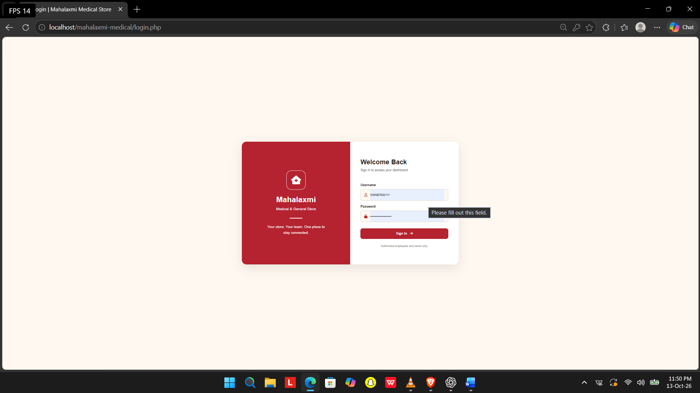
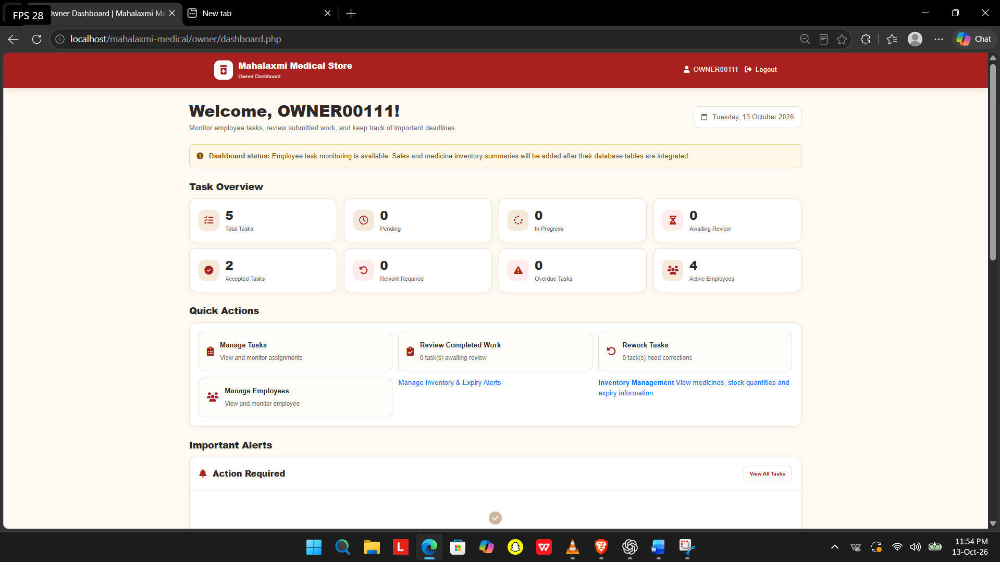
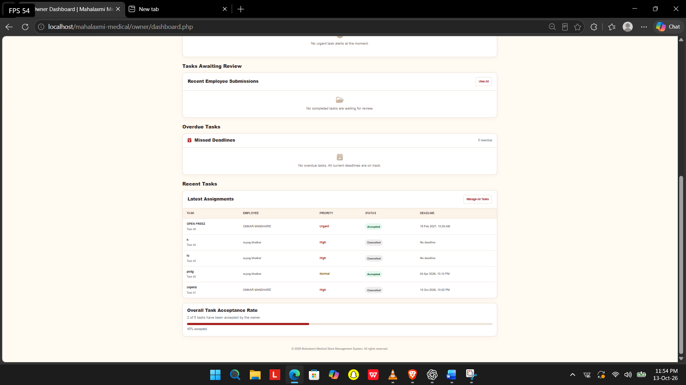
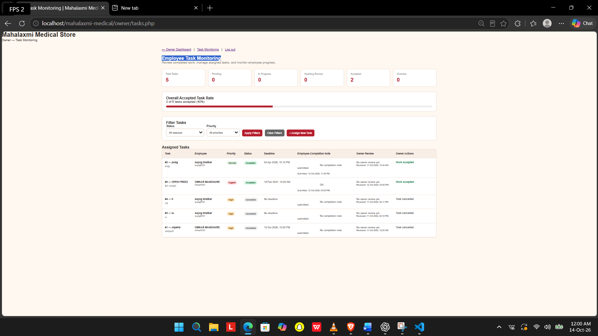
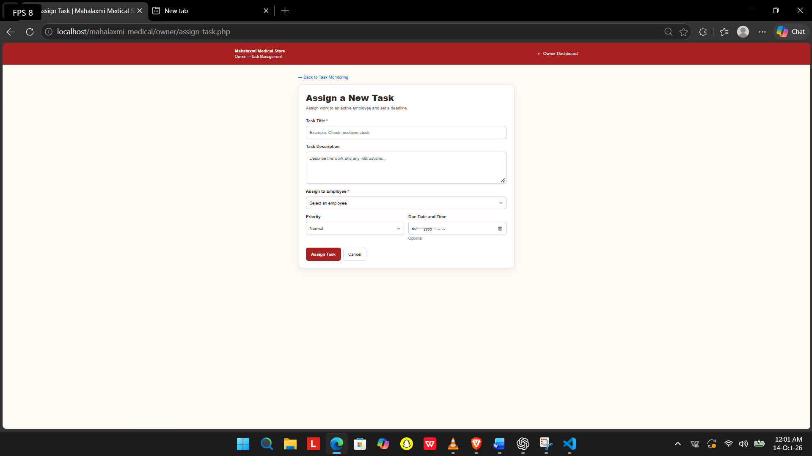
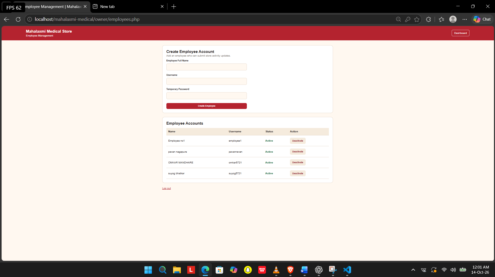
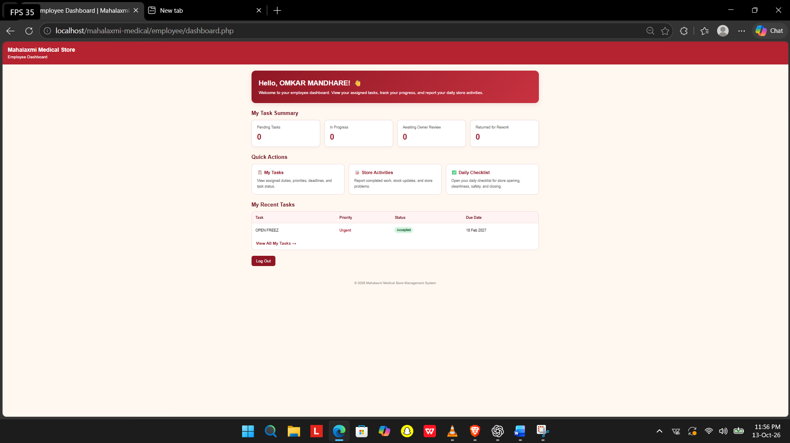
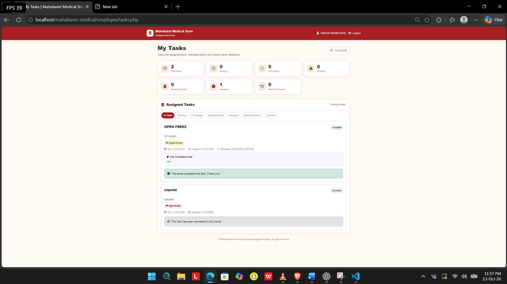
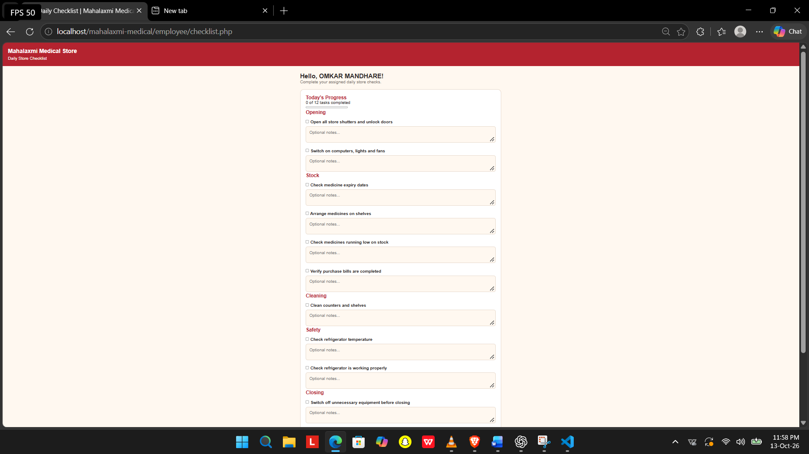
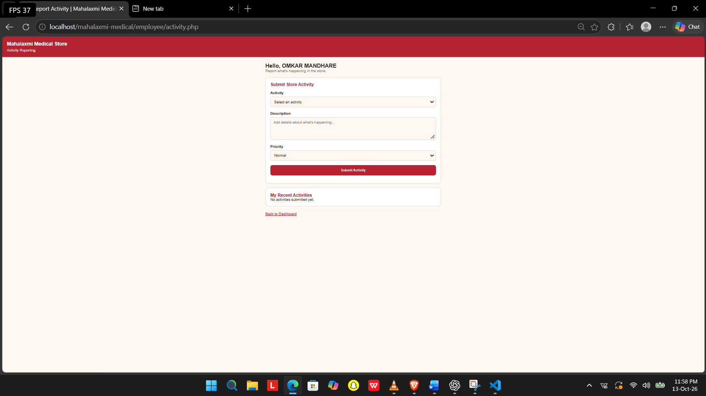

# Mahalaxmi Medical Store Management System

A PHP and MySQL web application being developed to help manage store operations, employee tasks, daily checklists, activity reports, and medicine inventory.

## Application Screenshots

These screenshots were supplied from the current application. The extra owner-dashboard image is included separately because the source document contains two images under that heading.

### 1. Login Page


### 2. Owner Dashboard




### 3. Employee Task Monitoring


### 4. Assign Task


### 5. Create Employee Account


### 6. Employee Dashboard


### 7. Task Management


### 8. Daily Checklist


### 9. Store Activities


## Main Goals

- Provide separate owner and employee access.
- Assign tasks and monitor their progress.
- Let employees submit completion notes and work updates.
- Support daily operational checklists.
- Record store activities and issues.
- Support medicine inventory tracking and stock/expiry alerts, where those modules are configured.

## Technology Stack

- **Frontend:** HTML, CSS, JavaScript
- **Backend:** PHP
- **Database:** MySQL
- **Local development:** XAMPP (Apache and MySQL)

## Run Locally

1. Install XAMPP and start Apache and MySQL.
2. Place the project folder inside `C:\xampp\htdocs\mahalaxmi-medical\`.
3. Open phpMyAdmin at `http://localhost/phpmyadmin`.
4. Create the project's database and import your actual project SQL/schema file, if available.
5. Update `config/database.php` with the matching local database settings.
6. Open `http://localhost/mahalaxmi-medical/` in your browser.
7. Sign in with an account that has already been created in the database.

> The exact database name, tables, and configuration must match the SQL schema and code in your current project. This README does not create database tables or user accounts.

## Project Structure
```text

mahalaxmi-medical/
├── README.md
├── screenshots/
│   ├── login-page.png
│   ├── owner-dashboard.png
│   ├── employee-task-monitoring.png
│   ├── assign-task.png
│   ├── create-employee-account.png
│   ├── employee-dashboard.png
│   ├── task-management.png
│   ├── daily-checklist.png
│   └── store-activities.png
├── index.php
├── login.php
├── owner/
├── employee/
├── assets/
└── database/

## Security Before Deployment

- Store passwords using PHP `password_hash()` and verify them with `password_verify()`.
- Use prepared SQL statements and enforce role checks on every protected page.
- Protect forms that change data with CSRF tokens.
- Use HTTPS in production and keep database credentials out of public repositories.
- Remove test accounts and sample data before launch.
- Back up the database and uploaded files regularly, and test restoring a backup.
- Do not expose real customer, employee, or business-sensitive data in screenshots or a public demo.

## Deployment

This application needs hosting that supports PHP and MySQL. GitHub Pages alone cannot execute PHP or connect to a MySQL database. Before publishing, test the application locally, export a database backup, configure the hosting database, upload the PHP files and import the schema, update production credentials, enable HTTPS, and test both owner and employee permissions.

## Development Status

This README documents the intended application and the screenshots provided. It does not certify that every module has been fully tested.

- [ ] Owner login and permissions tested
- [ ] Employee login and permissions tested
- [ ] Task assignment and review tested
- [ ] Daily checklist tested
- [ ] Store activities tested
- [ ] Inventory and expiry alerts tested
- [ ] Database backup and restore tested
- [ ] Production security review completed
